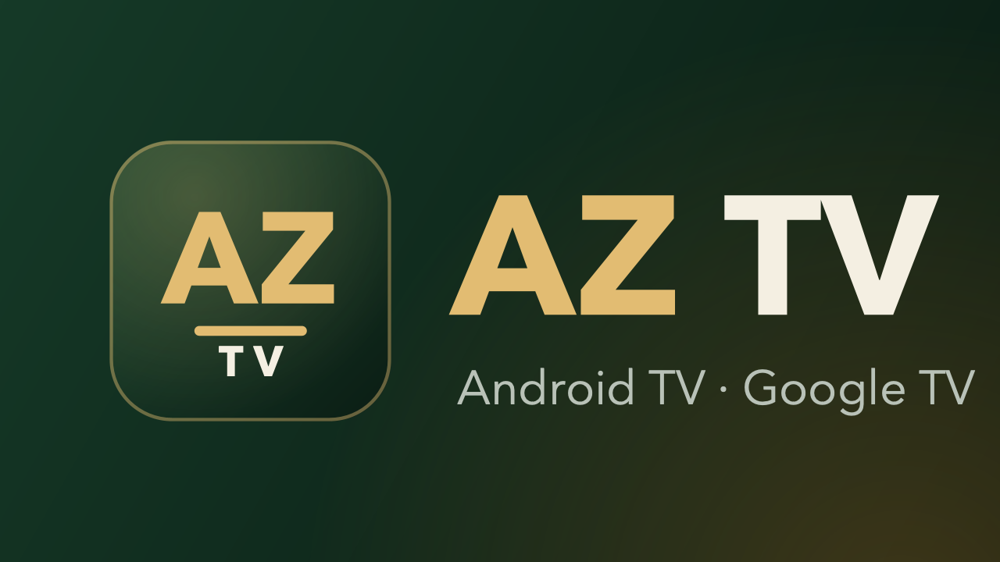
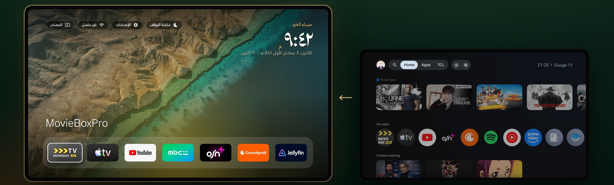
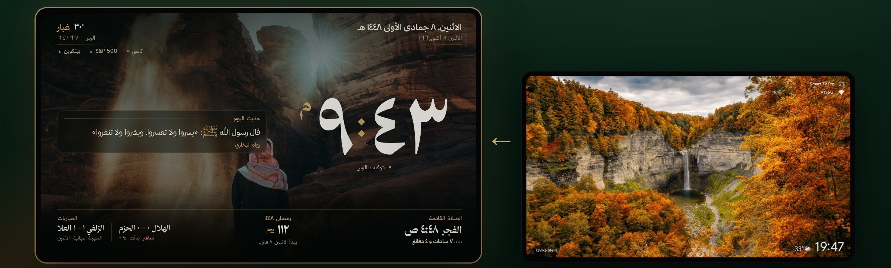

<p align="center"></p>

<h1 align="center">AZ TV</h1>

<p align="center" dir="rtl">واجهة رئيسية عربية بزجاج شفاف، وشاشة توقف سعودية، لتلفزيونات Android TV و Google TV.</p>
<p align="center">An Arabic liquid-glass home screen and a Saudi screensaver for Android TV / Google TV.</p>

<p align="center"></p>
<p align="center"></p>

<div dir="rtl">

## وش هو؟

تطبيقين لتلفزيونك:

| | |
|---|---|
| **AZ TV** · الواجهة الرئيسية (`urtv-home.apk`) | زجاج شفاف فوق صور من السعودية، بطاقة المباراة القادمة والصلاة والطقس، ترحيب باسمك، تطبيقاتك المفضلة تحت، مبدّل تطبيقات مثل الآيفون |
| **شاشة AZ TV** · شاشة التوقف (`urtv-screensaver.apk`) | ساعة كبيرة، التاريخ الهجري، الصلاة والإقامة، رمضان، مباريات فريقك، الطقس والأسواق، آية وحديث اليوم |

### المميزات
- **زجاج شفاف**: البطاقات والشريط العلوي والتطبيقات، والخلفية تتغير كل نصف ساعة.
- **حسابات «مين يشاهد اليوم؟»**: لكل واحد في البيت حسابه، برمز سري إذا تبغى، وتطبيقاته وإعداداته وصوره.
- **صور من الجوال**: امسح الرمز وارسل صورك، تصير خلفية حسابك وشاشة التوقف.
- **الواجهة الثابتة** (جديد): تبقى AZ TV هي الواجهة الرئيسية، وإذا رجعت واجهة التلفزيون الأصلية بعد تحديث أو إعادة تشغيل ترجّع AZ TV نفسها.
- **إعدادات لكل حساب**: أي لوحات تظهر، الساعة ١٢/٢٤، الأرقام عربية أو إنجليزية، المدينة والفرق.
- **التطبيقات المفتوحة**: سكّر أو أعد تشغيل أو احذف أي تطبيق.

## التركيب على التلفزيون

1. ثبّت **Downloader** من متجر Google Play على التلفزيون، واسمح له بتثبيت التطبيقات من
   **الإعدادات ← الخصوصية ← الأمان والقيود ← مصادر غير معروفة**.
2. نزّل الملفين من [Releases](../../releases/latest) (أو من موقع التنزيل) وثبّتهما.
3. افتح **AZ TV** ← **الإعدادات** ← **الواجهة الرئيسية الثابتة**، ووافق على الأسئلة.
4. لشاشة التوقف: **الإعدادات ← النظام ← شاشة التوقف** واختر **شاشة AZ TV**.

> إذا طلع «التطبيق غير آمن»: هذا تحذير Google Play Protect لأي تطبيق من خارج المتجر. اضغط **More details** ثم **Install anyway**.

## موقع التنزيل

مجلد [`site/`](site) صفحة ثابتة فيها شرح الفكرة وأزرار التنزيل.

```bash
android/build-local.sh        # يبني الملفين في android/out
site/serve.sh                 # يجمّع الموقع في site/out ويشغّله على الشبكة المحلية
NO_SERVE=1 site/serve.sh      # يجمّعه فقط، للرفع على أي استضافة ثابتة (مثل Netlify Drop)
```

</div>

## For developers

```
src/template.html     the screensaver page (HTML/CSS/JS, no framework); edit it, then run src/build.py
src/build.py          builds the two pages in dist/
android/app           the screensaver app (sa.urtv.screensaver): DreamService, settings
android/launcher      the home screen (sa.urtv.home): home, accounts, settings, app switcher, home keeper
android/build-local.sh  builds both APKs without Gradle (JDK 17 + a few single files in ~/.urtv-tools)
assets/ photos/       fonts, backgrounds, the hosted photo set (served from this repo's raw URLs)
optimize/             ADB tools to install and speed up a TV from a computer
site/                 the download page
docs/                 setup prompts, notes on real TVs, photo credits
```

The package names (`sa.urtv.*`) are kept so that installed copies update in place.
APKs are signed with a local key (`~/.urtv-tools/debug.keystore`): keep it, or the next build will not install over the
old one. `.github/workflows-off/` holds the original CI jobs, switched off (they need repository secrets); move them
back to `.github/workflows/` to use them.

## Credits

AZ TV is built on [UrTV](https://github.com/tshi-dev/UrTV). The home screen grew from
[mihirgupta0900/tv-home](https://github.com/mihirgupta0900/tv-home) (MIT, see
[android/launcher/LICENSE-tv-home](android/launcher/LICENSE-tv-home)) and its look follows
[TurkiHassan/custom-tv-arabic](https://github.com/TurkiHassan/custom-tv-arabic); the layout of tabs, greeting,
widget pages and large tiles follows [0xProbabillity/luma-tv](https://github.com/0xProbabillity/luma-tv) 2.4 (MIT). Photos: [docs/PHOTO-CREDITS.md](docs/PHOTO-CREDITS.md).
